# Kommunekonto – how it works

A local proof of concept that lets a Norwegian kommune:

1. pick itself from the official register (Brreg),
2. prove that the person is a kommune employee (a code sent to their work email),
3. choose a handle, ideally on the kommune's own domain,
4. get an AT Protocol account created for it,
5. connect its news feed, which a bot then posts to the account automatically.

Everything runs on one machine against the `local-sandbox` PDS. This document
explains what the pieces are and how they work together. The code itself is
not published.

The wizard's text is in Nynorsk. This document is in English.

---

## 1. The big picture

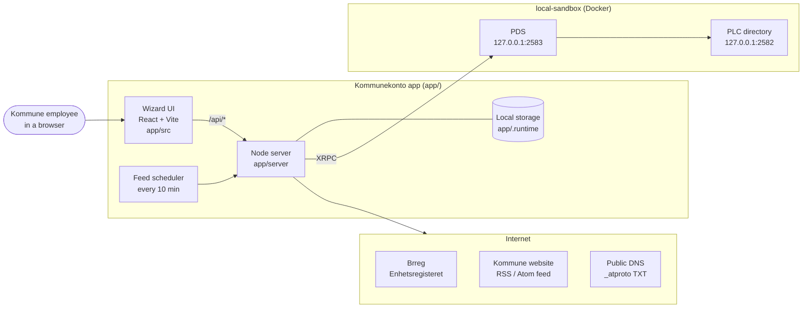

| Piece | What it does |
| --- | --- |
| **Wizard UI** | Five steps in one page. Talks only to its own server. |
| **Node server** | All rules and all outside calls. Holds the passwords. |
| **Scheduler** | Runs inside the server and syncs every connected feed. |
| **PDS** | Where the accounts and posts live. In the sandbox it has no internet access. |
| **Brreg** | Source of the 357 kommuner, their domains and their written language (Nynorsk or Bokmål). |
| **Kommune website** | Where the news comes from. |
| **DNS** | Proves that a kommune controls a domain before the account's handle moves there. |

---

## 2. The wizard, step by step

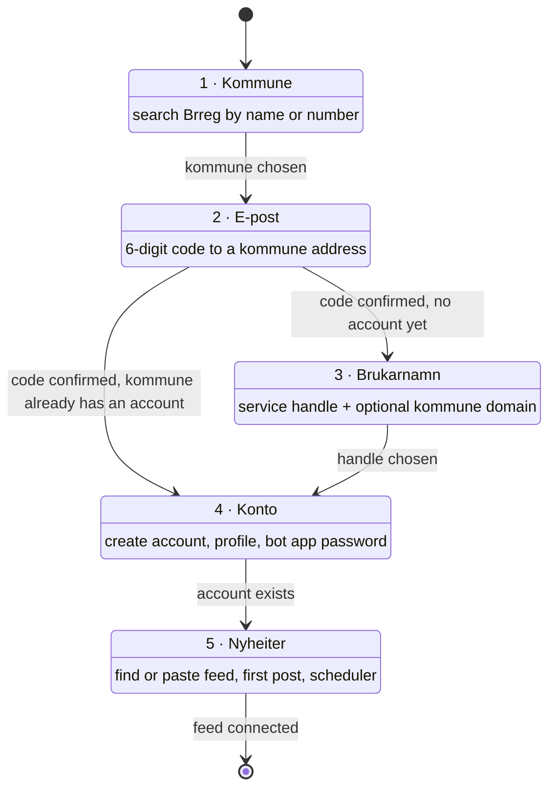

Every step after the email step needs a **verified cookie**. The server reads the
kommune from that cookie, never from what the browser sends, so nobody can act
for a kommune they have not verified for.

### Step 1 – Kommune

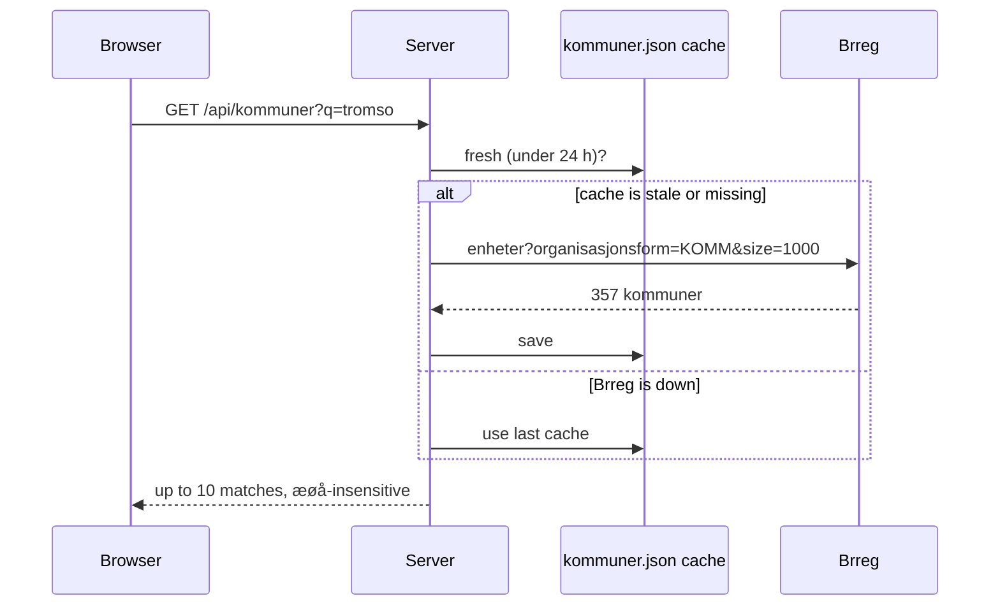

For each kommune the server works out:

- **Allowed email domains:** the homepage host without `www.`, plus the domain of
  Brreg's email address. 354 of 357 have at least one.
- **Post language:** `nn` for Nynorsk and `nb` for Bokmål, from Brreg's `maalform`.

`TEST_KOMMUNE_DOMAINS=devotta.no` adds a fake **Testkommune** (orgnr 999999990)
for testing.

### Step 2 – Email code

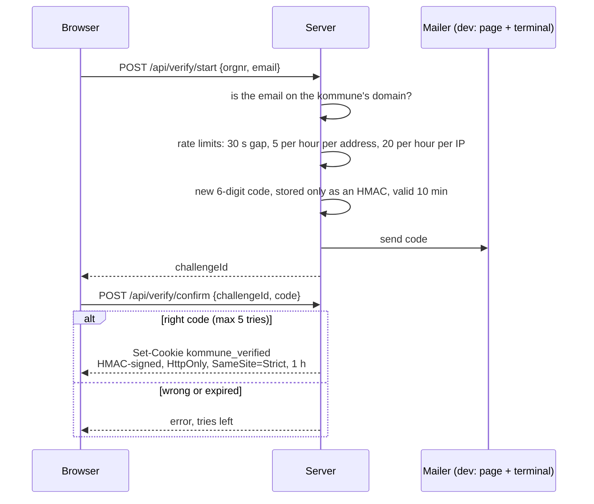

There is **no real email sending yet**. In `pnpm dev` the mail is printed in
the terminal and shown in a "Prototype-innboks" box on the page.

### Step 3 – Handle

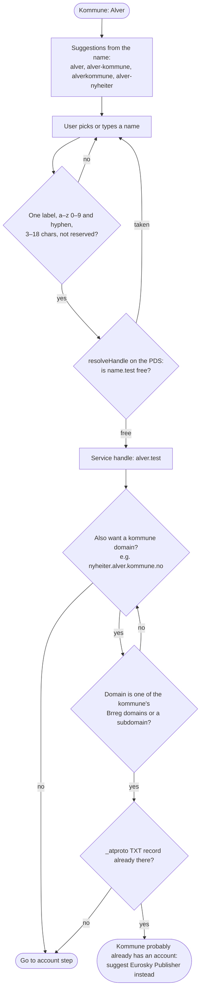

The account always starts on the service handle. The kommune domain is saved
and switched to later (see section 4), because the DNS record has to contain
the account's DID, which only exists after the account is created.

### Step 4 – Create the account

A "pending" record is written **before** the PDS call. If the PDS gives an unclear
answer, the attempt is not lost or repeated by accident.

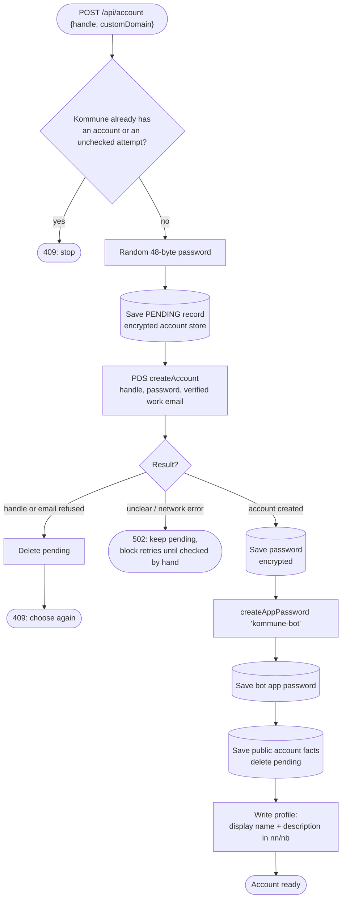

Two choices worth knowing:

- The account gets the **verified work email**. The kommune can then reset the
  password through the PDS, so it is never locked to this service.
- The bot gets its own **app password**. The main password is only used to
  change the handle.

### Step 5 – Connect the news feed

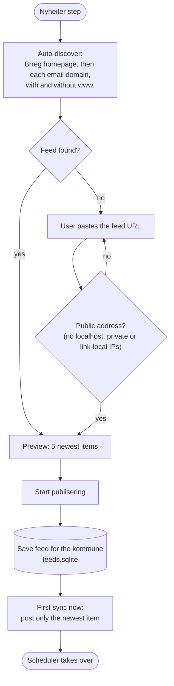

The step also has "Sjekk feeden no" (run now), pause/resume, the last run's
result, the total posted, and the latest posts read back from the PDS.

---

## 3. The bot

### One sync

The same `syncFeed` runs from the wizard, the scheduler and the `pnpm feed` CLI.

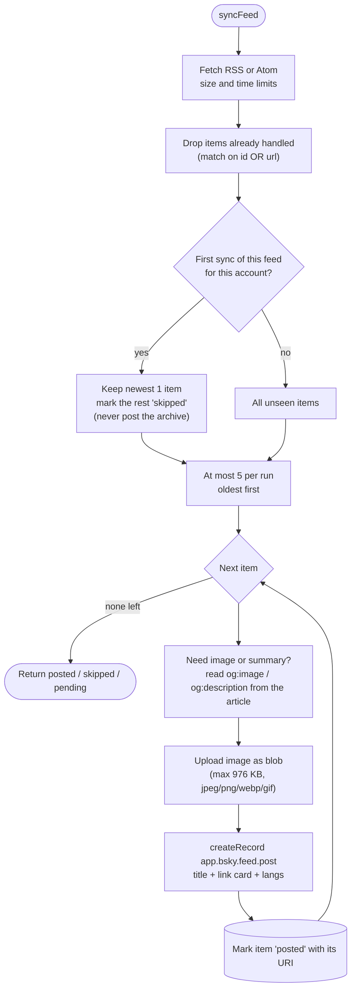

A missing or too-large image only means the link card has no picture. It never
stops the post.

### What a post looks like

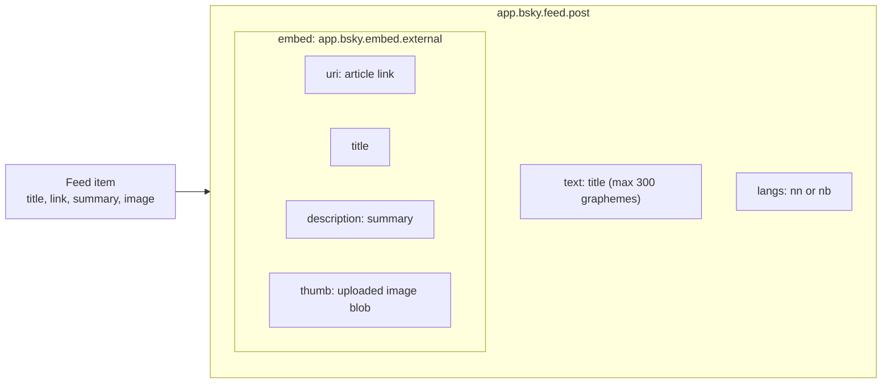

### Scheduler and runner

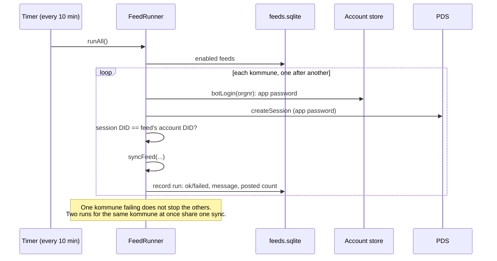

Settings: `FEED_INTERVAL_MINUTES` (default 10), `FEED_SCHEDULER=off` to turn it off.

---

## 4. Moving the handle to the kommune's domain

This can't be tested in the sandbox, because the sandbox PDS has no DNS and its
DIDs only exist in the local PLC. It needs the shared hackathon PDS.

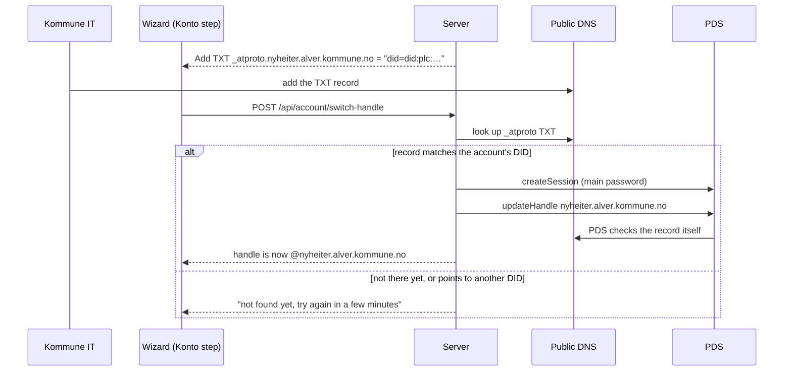

---

## 5. Where data is kept

All of it is under `app/.runtime/` and **not** in git. This is local
prototype storage, not a production design.

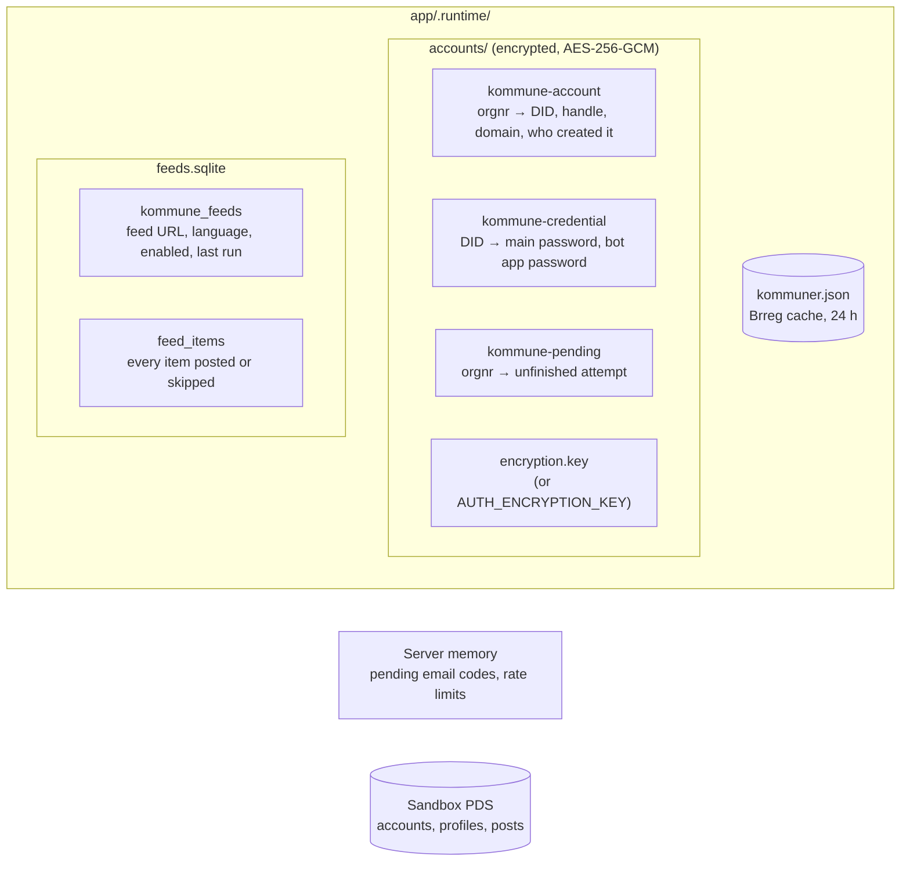

| Data | Lives in | Lost when |
| --- | --- | --- |
| Email codes, rate limits | Server memory | The server restarts |
| Verified cookie | Browser, signed with `VERIFY_SECRET` | After 1 h, or on restart if no secret is set |
| Passwords | `accounts/`, encrypted | The folder or key is deleted |
| What was posted | `feeds.sqlite` | The file is deleted |
| Accounts and posts | Sandbox PDS | The sandbox is stopped or restarted |

---

## 6. Code map

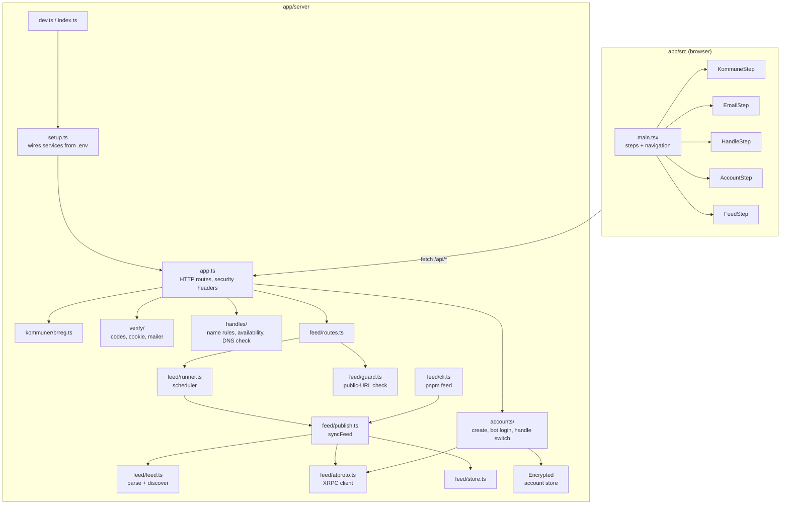

Reused from Demokratiløftet:

| Repo | How it is used |
| --- | --- |
| `local-sandbox` | The PDS and PLC everything runs against |
| `app-protospace` | The app template (React, Vite, Node server, checks) |
| `organisation-verifier` | Reference for the Brreg lookups |

---

## 7. API

All `POST` requests must come from the app's own origin. All routes except
`/api/kommuner*` need the verified cookie.

| Method | Path | What it does |
| --- | --- | --- |
| GET | `/api/kommuner?q=` | Search kommuner (max 10) |
| GET | `/api/kommuner/<orgnr>` | One kommune |
| POST | `/api/verify/start` | Send a code `{orgnr, email}` |
| POST | `/api/verify/confirm` | Check the code `{challengeId, code}`, sets the cookie |
| GET | `/api/verify/status` | Who is verified, if anyone |
| POST | `/api/verify/reset` | Forget the verification |
| GET | `/api/handle/options` | Name suggestions and the service domain |
| GET | `/api/handle/check?name=&domain=` | Is this handle valid and free? |
| GET | `/api/handle/custom?domain=` | Is this kommune domain allowed and unused? |
| GET | `/api/account` | The kommune's account and DNS status |
| POST | `/api/account` | Create the account `{handle, customDomain?}` |
| POST | `/api/account/switch-handle` | Move to the kommune domain once DNS is ready |
| GET | `/api/feed` | Connected feed, last run, latest posts |
| GET | `/api/feed/discover` | Look for a feed on the kommune's domains |
| GET | `/api/feed/preview?url=` | 5 newest items of a feed |
| POST | `/api/feed` | Connect a feed `{url}` and run the first sync |
| POST | `/api/feed/run` | Sync now |
| POST | `/api/feed/enabled` | Pause or resume `{enabled}` |

---

## 8. Security measures

| Risk | Measure |
| --- | --- |
| Someone acts for a kommune they don't work for | Email code to the kommune's own domain. The server takes the kommune from the signed cookie, not from the request |
| Guessing codes | 6 digits, 5 tries, 10 minutes, stored only as an HMAC |
| Spamming codes | 30 s between sends; 5 per hour per address; 20 per hour per IP |
| Cross-site requests | Cookie is `HttpOnly` and `SameSite=Strict`; every `POST` is checked for the app's own `Origin` |
| Stolen passwords at rest | Encrypted with AES-256-GCM |
| A leaked bot password | The bot only has an app password, which can be revoked without touching the account |
| The kommune locked out | Account uses their work email, so they can reset the password at the PDS |
| Feed URL pointing inside the network (SSRF) | Only public addresses are allowed; localhost, private and link-local IPs are refused |
| Posting a whole archive at once | First sync posts 1 item; later runs at most 5 |
| Page injection | Strict Content-Security-Policy, `nosniff`, no referrer, no framing |

---

## 9. What is still missing

- Real email sending instead of the dev mailer.
- Testing on the shared hackathon PDS: the kommune-domain handle switch, and
  seeing posts in a real Bluesky or Eurosky app (the sandbox has no AppView).
- A real storage design (codes are in memory; SQLite files under `.runtime/`).
- A manual approval path for kommuner with no domain in Brreg (Loppa, Lyngdal,
  Ullensvang) and for account attempts that ended without a clear answer.
- A news-only feed or a filter for CMSs that mix news with service pages
  (Alver's Prokom site).
- An SSRF check that also follows redirects (today only the first address is checked).
- Only 1 of 11 kommuner tried (Alver) had a usable feed, so most kommuner
  will need to paste a feed URL or get one set up.
